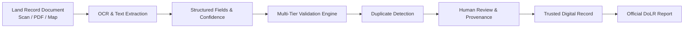
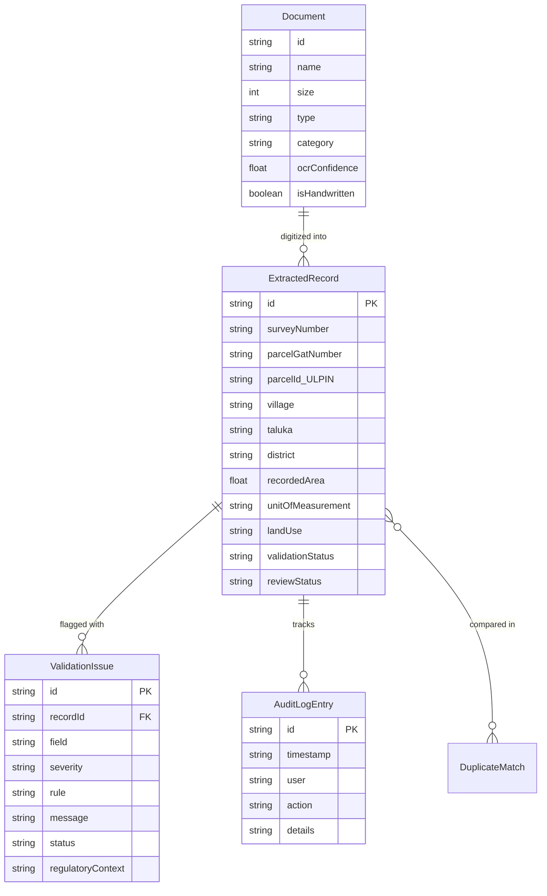

# RecordWise AI
### Intelligent Land Record Digitization and Validation System
> *"From Old Land Records to Trusted Digital Data."*

[](https://www.sih.gov.in/)
[](https://www.sih.gov.in/)
[](#)
[-202A5A.svg)](#)
[](#)
[](#)
[](#)
[](#)

---

## 1. Project Overview

**RecordWise AI** is an intelligent full-stack software solution developed for **Smart India Hackathon 2026 (Problem Statement ID: SIH26018)** under the **Ministry of Rural Development, Department of Land Resources (DoLR)**.

India's land registries encompass millions of legacy cadastral documents—dating from colonial land settlements through post-independence state consolidations—stored as physical handwritten registers, faded paper ledgers, scanned raster PDFs, and cadastral maps (Nakshas). Manual transcription of these documents into modern digital registries (such as the Digital India Land Records Modernization Programme - DILRMP) is labour-intensive and prone to human error, missed sub-divisions (Hissa / Pot-Hissa), duplicate parcel allocations, and area discrepancies.

RecordWise AI demonstrates an end-to-end, trustworthy workflow that transforms scanned and handwritten legacy land records into structured, validated, and auditable digital entries without ever claiming to determine legal title or replace judicial dispute mechanisms.

---

## 2. SIH 2026 Problem Statement Details

- **Problem Statement ID:** `SIH26018`
- **Problem Statement Title:** Intelligent Land Record Digitization and Validation System
- **Organization:** Ministry of Rural Development
- **Department:** Department of Land Resources (DoLR)
- **Category:** Software
- **Theme:** Smart Automation

---

## 3. Problem Statement

Many land records across Indian states remain locked in handwritten registers, scanned document archives, cadastral maps, and legacy PDF files. Digitizing these records manually is time-consuming, expensive, and frequently introduces:
1. **Transcription & Character Errors:** Confusion between similar numerals (e.g., `0` vs `O`, `1` vs `7`) and regional script transliterations (Devanagari, Kannada, Urdu, Modi).
2. **Missing Mandatory Attributes:** Omission of land use classification, revenue survey numbers, or co-tenancy shares.
3. **Area Discrepancies:** Conflicts between historical ledger areas and subsequent digitized extract measurements.
4. **Duplicate Record Allocations:** Redundant entries for the same survey root or unpartitioned family parcels.
5. **Lack of Provenance:** Lack of transparent audit trails tracking when a field was extracted vs. manually corrected.

---

## 4. Proposed Solution

RecordWise AI solves this through an automated, human-in-the-loop pipeline:



### Key Principles
- **No Hallucinated Ownership:** The platform strictly supports administrative record-processing workflows and explicitly disclaims legal ownership determination.
- **Explainable AI:** Server-side Google Gemini 3.8 Flash models explain regulatory discrepancies and anomalies to revenue officers instead of performing opaque automated actions.
- **Dual-Verification for Handwritten Scripts:** Explicitly marks handwritten extractions with realistic confidence thresholds (65%–80%) and enforces mandatory human sign-off.
- **Non-Destructive Duplicate Handling:** Duplicate matches are flagged for neutral side-by-side comparison; records are never silently overwritten or merged.

---

## 5. Key Features

| Feature | Description |
|---|---|
| **Intelligent Document Ingestion** | Drag-and-drop support for PDF, JPG, PNG, and TIFF formats with file-size and type validation. |
| **OCR & Character Confidence Scoring** | Side-by-side scanned document view, raw OCR text inspection, and field-level confidence ratings (`98% Survey`, `78% Area`). |
| **Structured Land Record Fields** | Extraction and mapping into standardized DILRMP / Bhu-Aadhaar attributes (Survey No, Gat No, ULPIN, Village, Taluka, Area, Unit, Land Use). |
| **Visual Provenance Classification** | Clear visual badges distinguishing *Clearly Extracted*, *User Corrected*, *Needs Review*, and *Missing* fields. |
| **Multi-Tier Validation Rules Engine** | Automated validation checks for missing required fields, unit consistency, area discrepancies, and spatial hierarchy. |
| **Duplicate Detection & Comparison** | Side-by-side comparative inspection highlighting matching identifiers and conflicting fields with neutral status indicators. |
| **Human Review Sign-Off** | Full audit trail tracking user role, timestamp, old value, new value, and reviewer justification note. |
| **Official PDF / Print Report Generator** | Generates standardized DoLR Land Record Digitization and Validation Summary certificates with functional browser print/PDF export. |
| **Interactive 10-Step SIH Demo Mode** | Guided 2-minute walkthrough designed for hackathon evaluators with pre-loaded realistic Indian land record scenarios. |

---

## 6. How It Works

1. **Upload:** User uploads a scanned legacy document or selects a pre-configured sample Indian land record (Maharashtra 7/12 Satbara, Karnataka Bhoomi RTC, UP Khasra/Khatauni, or MP Handwritten Register).
2. **Extract:** Text is extracted and mapped to structured fields. Character confidence scores are assigned to every attribute.
3. **Structure & Edit:** Operators inspect the extracted data against the scanned document preview and can correct illegible values.
4. **Validate:** Automated business rules run against regional cadastral constraints. Issues are classified into *Error*, *Warning*, or *Needs Review*.
5. **Duplicate Check:** Identical or overlapping survey identifiers within the same village are matched and scored.
6. **Human Review:** Authorized officers review discrepancies, read AI-assisted regulatory context, and record their sign-off.
7. **Report:** An official compliance summary report is generated and exported.

---

## 7. OCR and Document Processing

The OCR studio provides:
- **6 Processing Stages:** Document Uploaded → Text Extraction → Field Identification → Data Structuring → Validation → Review Required.
- **Multilingual Recognition:** Sample support for Devanagari (Marathi/Hindi), Kannada (Bhoomi schema), and English revenue terminologies.
- **Handwritten Disclaimers:** Explicit transparency indicating that aged handwritten ledgers have lower optical confidence and require mandatory two-tier manual verification.
- **Backend AI Extraction Analysis:** Optional document analysis powered by Google Gemini 3.8 Flash (`POST /api/gemini/analyze-document`) which highlights potential OCR transcription risks (e.g., smudged ink or faded marginalia).

---

## 8. Structured Data Extraction

Each record is organized into standard cadastral schemas:
- **Record Identifier:** e.g., `REC-MH-2024-1024A`
- **Cadastral Numbers:** Survey Number, Sub-division (Hissa / Pot-Hissa), Gat / Plot Number.
- **Unique Parcel Identifier:** 14-digit Bhu-Aadhaar / ULPIN format.
- **Revenue Hierarchy:** Village (Mouje), Taluka (Tehsil), District, State.
- **Extent:** Recorded Area & Unit (`sq.m`, `Hectare`, `Acre`, `Guntha`, `Bigha`).
- **Classification:** Land Use (`Agricultural`, `Non-Agricultural`, `Commercial`, `Residential`, `Wasteland`, `Forest`).
- **Co-Tenants:** Registered Khatedars with fractional shares and occupant classes.
- **Source Provenance:** Document reference number, date, and audit trail of modifications.

---

## 9. Validation Center

The validation engine performs automated integrity checks:
1. **Required Fields Check:** Flags missing mandatory attributes (such as land use classification in water-damaged registers).
2. **Area Discrepancy Verification:** Detects numerical deviations between historical baseline registers and newly digitized extracts (e.g., +30 sq.m divergence in Survey 1024).
3. **Co-Tenancy Share Breakdown:** Flags unapportioned fractional shares among joint khatedars.
4. **OCR Confidence Threshold:** Flags any record digitized below an 80% confidence threshold for second-tier reviewer approval.

### Explain with AI
Officers can click **"Explain with AI"** to query the server-side Gemini 3.8 Flash model (`POST /api/gemini/explain-issue`), which returns:
- Technical explanation of the discrepancy.
- Regulatory context under DoLR and state Land Revenue Codes.
- Recommended administrative action for the reviewer.

---

## 10. Duplicate Detection & 11. Record Comparison

The platform includes a dedicated duplicate detection hub that identifies potential overlaps:

```
Record A: Survey No: SUR-1024/2A | Village: Wagholi | Area: 1,850 sq. m
Record B: Survey No: SUR-1024    | Village: Wagholi | Area: 1,820 sq. m
Status: Potential Duplicate — Review Required (91% Match Score)
```

### Side-by-Side Comparison
- **Matching Fields (Green):** Village, Taluka, District, State, Gat Number root.
- **Conflicting Fields (Amber/Red):** Recorded Area (+30 sq.m variance), Record Dates (2024 vs 1984), Owner lists.
- **Neutral Administrative Actions:**
  - `Duplicate Confirmed`
  - `Not a Duplicate (Valid Sub-division)`
  - `Requires Further Field Survey`

---

## 12. Human Review Workflow

Under Indian revenue administrative procedures, automated algorithms must never unilaterally alter land registers. RecordWise AI enforces:
- **Role-Based Perspectives:** Switch between *Revenue Officer (SDO/Tehsildar)*, *Digitization Operator*, and *Survey Reviewer*.
- **Provenance Logging:** Any manual correction records the actor's role, timestamp, previous value, new value, and administrative justification.
- **Sign-Off Block:** Reports include the operator ID and authorized reviewer digital signature block.

---

## 13. Technology Stack

- **Frontend:** React 19, TypeScript, Tailwind CSS v4, Lucide React icons, Motion.
- **Backend / Server:** Node.js, Express 4.x, Vite dev server middleware.
- **AI / Generative Model:** `@google/genai` TypeScript SDK (server-side only, model: `gemini-3.8-flash`).
- **Styling Architecture:** Custom DoLR colour palette tokens in CSS variables (`Midnight Indigo #202A5A`, `Cyan #0891B2`, `Mint Green #D1FAE5`, `Amber #D97706`, `Red #DC2626`).

---

## 14. System Architecture

```
┌────────────────────────────────────────────────────────┐
│                   Client Browser (React 19)            │
│  - Dashboard & Pipeline Metric Views                   │
│  - OCR Studio & Side-by-Side Scanned Document Viewer   │
│  - Master Digital Records Table (Search, Filter, CSV)  │
│  - Validation Center & Discrepancy Queue               │
│  - Duplicate Detection & Side-by-Side Comparison       │
│  - Print & PDF Report Generator                        │
└───────────────────────────┬────────────────────────────┘
                            │ REST JSON Calls
                            ▼
┌────────────────────────────────────────────────────────┐
│             Server-Side Engine (Express / Node.js)     │
│  - GET  /api/health                                    │
│  - POST /api/gemini/analyze-document                   │
│  - POST /api/gemini/explain-issue                      │
│  - POST /api/gemini/compare-records                    │
└───────────────────────────┬────────────────────────────┘
                            │ Server-to-Server HTTPS
                            ▼
┌────────────────────────────────────────────────────────┐
│             Google Gemini API (gemini-3.8-flash)       │
│  - Regulatory & Cadastral Reasoning                    │
│  - Transcription Anomaly Detection                     │
│  - Non-Legal Explainability Synthesis                  │
└────────────────────────────────────────────────────────┘
```

---

## 15. Database Architecture

The data model is structured for land record provenance and audit compliance:



---

## 16. API Documentation

All API endpoints are strictly server-side:

### `GET /api/health`
Returns system operational status and AI backend readiness.

### `POST /api/gemini/explain-issue`
Generates an objective, neutral explanation of a validation discrepancy for revenue officers.
- **Request Body:**
  ```json
  {
    "rule": "Area Discrepancy Across Records",
    "field": "recordedArea",
    "currentValue": "1850 sq.m",
    "recordContext": {
      "recordId": "REC-MH-2024-1024A",
      "surveyNumber": "SUR-1024/2A",
      "village": "Wagholi",
      "district": "Pune",
      "recordedArea": 1850,
      "unitOfMeasurement": "sq.m"
    }
  }
  ```

### `POST /api/gemini/analyze-document`
Analyzes raw OCR text to detect transcription errors and summarize parcel scope.

### `POST /api/gemini/compare-records`
Compares Record A and Record B neutrally and categorizes the overlap.

---

## 17. Project Structure

```
├── .env.example                 # Template for runtime environment variables
├── .gitignore                   # Excludes node_modules, build, .env, and uploads
├── index.html                   # HTML entry point with synchronized metadata & fonts
├── metadata.json                # Project branding and major capabilities declaration
├── package.json                 # Project dependencies and npm scripts
├── README.md                    # Official documentation
├── server.ts                    # Production Express full-stack entry point
├── server/
│   ├── api.ts                   # Express router for /api endpoints
│   └── geminiService.ts         # Server-side Gemini 3.8 Flash client utility
├── src/
│   ├── App.tsx                  # Main application container & view router
│   ├── index.css                # Tailwind CSS v4 variables & design tokens
│   ├── main.tsx                 # React DOM mount entry
│   ├── types/
│   │   └── index.ts             # Domain TypeScript interfaces (LandRecord, ValidationIssue, etc.)
│   ├── data/
│   │   └── sampleRecords.ts     # Realistic Indian land records (Maharashtra, Karnataka, UP, MP)
│   ├── context/
│   │   └── RecordWiseContext.tsx# Central application state & SIH demo engine
│   └── components/
│       ├── layout/
│       │   ├── Header.tsx       # Header bar with role selector and demo trigger
│       │   └── Sidebar.tsx      # Midnight Indigo navigation drawer
│       ├── dashboard/
│       │   └── DashboardView.tsx# Pipeline metric cards & quick actions
│       ├── upload/
│       │   └── UploadView.tsx   # Drag-and-drop file upload & sample picker
│       ├── ocr/
│       │   └── OcrProcessingView.tsx # Side-by-side OCR viewer & field editor
│       ├── records/
│       │   └── DigitalRecordsView.tsx# Searchable records table with CSV export
│       ├── validation/
│       │   └── ValidationCenterView.tsx # Multi-tier validation & AI explainability
│       ├── duplicates/
│       │   └── DuplicateDetectionView.tsx# Side-by-side duplicate comparison
│       ├── reports/
│       │   └── ReportsView.tsx  # DoLR compliance certificate & PDF printer
│       └── demo/
│           └── SihDemoGuideModal.tsx # 10-step interactive SIH demo tour
├── tsconfig.json                # TypeScript compiler configuration
└── vite.config.ts               # Vite configuration with embedded API middleware
```

---

## 18. Prerequisites

- **Node.js:** v18.0.0 or higher
- **npm:** v9.0.0 or higher
- **Gemini API Key:** (Optional for live AI explanations; high-quality rule-based fallback included automatically when no key is present)

---

## 19. Installation

Clone or extract the repository, then install dependencies:

```bash
npm install
```

---

## 20. Environment Variables

Create a `.env` file based on `.env.example`:

```bash
# GEMINI_API_KEY: Optional for dynamic Gemini AI validation analysis.
# If omitted, RecordWise AI operates with built-in rule heuristics.
GEMINI_API_KEY="YOUR_GEMINI_API_KEY"

# APP_URL: Host URL
APP_URL="http://localhost:3000"
```

---

## 21. Running the Project

### Development Mode (Vite + Express Middleware):
```bash
npm run dev
```
Open your browser at `http://localhost:3000`.

### Production Build & Server:
```bash
npm run build
npm start
```

---

## 22. SIH Demo Instructions (2-Minute Evaluator Tour)

1. Open the application dashboard in your browser.
2. Click the prominent **"Run SIH Demo"** button in the top navigation bar.
3. Follow the guided 10-step interactive overlay:
   - **Step 1:** Review the 4-stage pipeline metrics on the dashboard.
   - **Step 2:** Inspect the uploaded sample records (Maharashtra 7/12 Satbara extract).
   - **Step 3:** View the side-by-side scanned extract and Marathi/Devanagari OCR text.
   - **Step 4:** Review field-level confidence ratings (`Survey: 98%`, `Area: 78%`).
   - **Step 5:** Note the warning badge on the recorded area.
   - **Step 6:** Navigate to the Validation Center and click **"Explain with AI"** to see Gemini breakdown.
   - **Step 7:** Open Duplicate Detection and inspect the 91% match with historical Survey 1024.
   - **Step 8:** Review the side-by-side area divergence (+30 sq.m).
   - **Step 9:** Edit a field in the Digital Records table and verify the automatic audit log entry.
   - **Step 10:** Open Reports and click **"Print / Save as PDF"** to preview the official DoLR certificate.

All sample data is explicitly marked: `SIH DEMO — SIMULATED DATA`.

---

## 23. Security and Privacy

- **No Client API Keys:** Gemini API keys are accessed strictly server-side (`process.env.GEMINI_API_KEY`) and never bundled in client code.
- **Input Validation:** Strict file type filtering (`.pdf`, `.jpg`, `.jpeg`, `.png`, `.tiff`) and size enforcement (25 MB maximum).
- **Masked Identifiers:** Khatedar personal identity numbers (Aadhaar) are strictly masked.
- **Audit Trails:** All modifications are recorded with timestamp and actor role to prevent repudiation.

---

## 24. Limitations

- **Prototype Scope:** OCR text extraction for sample files is simulated using realistic regional revenue datasets to ensure dependable hackathon demonstrations.
- **Handwritten Variation:** Historical calligraphy (such as Modi script or cursive Urdu) requires high-resolution pre-processing and human-in-the-loop review.
- **Non-Judicial Authority:** Automated validations do not declare legal title or supersede court proceedings.

---

## 25. Future Scope

- **Integration with State Portals:** Direct APIs to Bhulekh (UP), Mahabhulekh (Maharashtra), Bhoomi (Karnataka), and Banglarbhumi (West Bengal).
- **Automated Cadastral GIS Vectorization:** Converting scanned cloth maps (Nakshas) into georeferenced GeoJSON boundary polygons.
- **Bhu-Aadhaar Blockchain Anchoring:** Immutable cryptographic hashing of validation sign-offs for tamper-proof provenance.

---

## 26. SIH Relevance & Government Impact

Under the **Digital India Land Records Modernization Programme (DILRMP)** and the **Unique Land Parcel Identification Number (ULPIN / Bhu-Aadhaar)** initiative, standardizing legacy paper registers into verifiable digital datasets is a paramount national priority. RecordWise AI provides a pragmatic, transparent, and operator-friendly bridge to achieve trusted land data digitization at national scale.

---

## 27. Statutory Disclaimer

> **RecordWise AI is a prototype developed for Smart India Hackathon 2026. OCR-extracted data and automated validation results may contain errors and require human review. Digitized records must not be treated as independent proof of legal ownership or as a replacement for official government land records. Demo data is simulated unless explicitly identified otherwise.**

---

## 28. Contributors

- **Smart India Hackathon 2026 Student Innovators** (Problem Statement SIH26018)

---

## 29. License

This project is licensed under the Apache License 2.0. Developed for demonstration purposes under Smart India Hackathon 2026.
